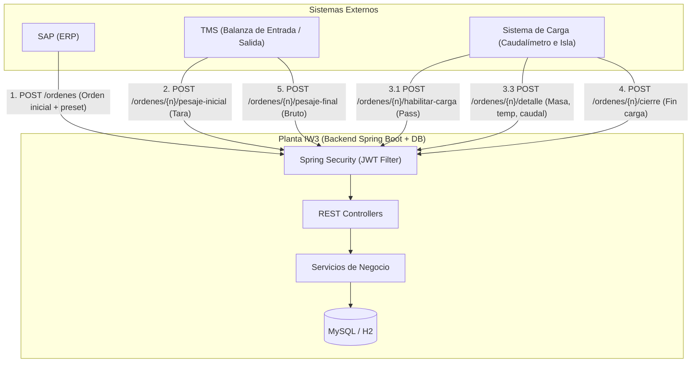

# Guía Definitiva de Preparación y Defensa del Coloquio Final
## Sistema de Gestión de Órdenes de Carga de Gas Licuado (GLP)
**Cátedra:** Ingeniería Web 3 · Ingeniería en Informática · IUA · 2026  
**Equipo:** Leandro Sposito (`lean`), Fran Giraudo (`fran`), Fabricio Bustos (`fabri`)

---

## Índice General

1. [Estrategia de la Presentación (15 Minutos Cronometrados)](#1-estrategia-de-la-presentación-15-minutos-cronometrados)
2. [Dominio de Negocio y Ciclo de Vida de la Orden](#2-dominio-de-negocio-y-ciclo-de-vida-de-la-orden)
3. [Los Dos Temas Teóricos Clave: OpenAPI V3 y WebSockets](#3-los-dos-temas-teóricos-clave-openapi-v3-y-websockets)
4. [Banco de Preguntas Frecuentes y Respuestas por Integrante](#4-banco-de-preguntas-frecuentes-y-respuestas-por-integrante)
   - [Preguntas para Fran (Seguridad, JWT, Filtros y Validaciones)](#preguntas-para-fran)
   - [Preguntas para Fabri (Monitoreo, Concurrencia, Alarmas y N+1)](#preguntas-para-fabri)
   - [Preguntas para Lean (Arquitectura, Conciliación, Docker y Postman)](#preguntas-para-lean)
5. [Guía Rápida de Comandos y Demostración en Vivo (Runbook)](#5-guía-rápida-de-comandos-y-demostración-en-vivo-runbook)

---

## 1. Estrategia de la Presentación (15 Minutos Cronometrados)

El profesor estableció un límite estricto de **15 minutos por grupo**, evaluando de forma individual a cada integrante. La distribución recomendada es:

```mermaid
gantt
    title Distribución de los 15 Minutos de Defensa
    dateFormat  m
    axisFormat %M min
    section Exposición
    Lean (Intro, Arquitectura, SAP/TMS, Conciliación) :0, 3m
    Fran (Seguridad, JWT, Validaciones, Login Vue)    :3, 6m
    Fabri (Monitoreo en vivo, Concurrencia, Alarmas)   :6, 9m
    section Preguntas & Demo
    Demostración Integrada en Vivo                     :9, 11m
    Ronda de Preguntas Individuales del Docente        :11, 15m
```



### Minuto a Minuto:

*   **Minuto 0:00 – 3:00 | Leandro Sposito (`lean`)**:
    *   **Introducción:** Contexto de la planta de GLP y los 3 sistemas externos (SAP, TMS, Sistema de Carga).
    *   **Arquitectura de Datos y Estados:** Transiciones unidireccionales (1 → 2 → 3 → 4), registro de auditoría en base de datos.
    *   **Conciliación:** Explicar la lógica de negocio (Balanza vs Caudalímetro, promedios) y mostrar la pantalla de Conciliaciones.
*   **Minuto 3:00 – 6:00 | Fran Giraudo (`fran`)**:
    *   **Seguridad:** Arquitectura stateless con Spring Security + JWT (HS256). Cadena de filtros (`JwtAuthenticationFilter`) antes de `UsernamePasswordAuthenticationFilter`.
    *   **Matriz de Roles:** Permisos específicos (`SAP`, `TMS`, `SISTEMA_CARGA`, `OPERADOR`, `ADMIN`).
    *   **Robustez y Validaciones:** Exclusión de `UserDetailsServiceAutoConfiguration`, validación de cisternas repetidas (`@AssertTrue`), límite de 255 caracteres en Bean Validation y 72 bytes en BCrypt.
    *   **Frontend Auth:** Manejo de sesión reactiva con Pinia y detección proactiva de token expirado.
*   **Minuto 6:00 – 9:00 | Fabricio Bustos (`fabri`)**:
    *   **Monitoreo en Vivo:** Cálculo dinámico de ETA y tiempo transcurrido en estado 2. Justificación técnica de Polling vs WebSockets.
    *   **Concurrencia en Alarmas:** Bloqueo pesimista (`@Lock(PESSIMISTIC_WRITE)`) con `409 Conflict` ante doble aceptación simultánea.
    *   **Mails Asíncronos:** Evento desacoplado con `@TransactionalEventListener(AFTER_COMMIT)` y envío no bloqueante con `@Async` hacia Mailpit.
    *   **Optimización JPA:** Eliminación del problema N+1 mediante `join fetch` y `@BatchSize(50)`.
*   **Minuto 9:00 – 11:00 | Demo Conjunta Rápida**:
    *   Recorrido en vivo de una orden desde el frontend o Postman (crear orden con SAP, pesaje inicial con TMS, carga y alarma con Sistema de Carga, ver mail en Mailpit, aceptar alarma con operador, cierre, pesaje final y visualización de la conciliación).
*   **Minuto 11:00 – 15:00 | Preguntas Individuales del Profesor**:
    *   Respuestas directas al hueso, citando la clase, el archivo y la justificación de diseño.

---

## 2. Dominio de Negocio y Ciclo de Vida de la Orden

### Los 3 Sistemas Externos y la Planta



### Ciclo de Estados y Reglas Estrictas

| Estado | Nombre | Disparador | Quién lo invoca | Acciones del Backend |
|---|---|---|---|---|
| **1** | `PENDIENTE_PESAJE_INICIAL` | `POST /api/v1/ordenes` | SAP (`sap`) | Sincroniza camión, chofer, cliente, producto por `codigoExterno` (Upsert). Guarda preset y fecha prevista. Crea auditoría. |
| **2** | `CON_PESAJE_INICIAL` | `POST /api/v1/ordenes/{n}/pesaje-inicial` | TMS (`tms`) | Registra pesaje inicial (tara). Genera con `SecureRandom` contraseña de activación de 5 dígitos (10000..99999) y la devuelve. |
| **2** | *En proceso de carga* | `POST /api/v1/ordenes/{n}/habilitar-carga` | Sistema Carga (`carga`) | Valida contraseña y estado 2. Devuelve el preset para calibrar la bomba. |
| **2** | *Ingesta de mediciones* | `POST /api/v1/ordenes/{n}/detalle` | Sistema Carga (`carga`) | Valida reglas físicas: caudal > 0, masa > 0 y masa >= anterior, densidad en (0, 1]. Si temperatura > umbral, dispara alarma. Aplica regla de frecuencia de almacenamiento. |
| **3** | `CERRADA_PARA_CARGA` | `POST /api/v1/ordenes/{n}/cierre` | Sistema Carga (`carga`) | Cierra la orden. Bloquea para siempre la recepción de nuevos datos de detalle (devuelve 409 si intentan cargar). |
| **4** | `FINALIZADA` | `POST /api/v1/ordenes/{n}/pesaje-final` | TMS (`tms`) | Registra peso final. Calcula y devuelve la conciliación. Habilita la consulta de conciliación. |

### Fórmulas Matemáticas de Negocio

1.  **Neto por Balanza:**
    $$\text{Neto Balanza} = \text{Pesaje Final} - \text{Pesaje Inicial (Tara)}$$
2.  **Diferencia de Conciliación:**
    $$\text{Diferencia} = \text{Neto Balanza} - \text{Producto Cargado (Última Masa del Caudalímetro)}$$
3.  **Promedios (Temperatura, Densidad, Caudal):**
    Calculados en base de datos mediante queries de agregación (`AVG(...)`) sobre las filas almacenadas en la tabla `detalle_carga`.
4.  **ETA de llenado (Estimación de Tiempo Restante):**
    $$\text{ETA (horas)} = \frac{\text{Preset} - \text{Última Masa Acumulada}}{\text{Último Caudal (kg/h)}}$$
    *Reglas:* Si no está en estado 2, si la masa ya alcanzó el preset, o si el caudal es $\le 0$, el ETA es `null` o `0`.
5.  **Tiempo transcurrido:**
    $$\text{Tiempo Carga} = \text{Último dato válido} - \text{Primer dato válido}$$

---

## 3. Los Dos Temas Teóricos Clave: OpenAPI V3 y WebSockets

El profesor subió clases de estos dos temas; **las preguntas de examen girarán sobre su aplicación en este proyecto.**

### Tema A: OpenAPI V3 (Swagger)

#### 1. ¿Qué es OpenAPI V3 y qué diferencia tiene con Swagger 2.0?
*   **OpenAPI 3.0** es la especificación estándar de la industria (respaldada por la Linux Foundation) para describir APIs REST de manera agnóstica al lenguaje.
*   *Diferencias clave con Swagger 2.0:*
    *   Soporte para múltiples servidores (`servers` en lugar de `host`, `basePath` y `schemes`).
    *   Estructura modular en `components` (reutilización de `schemas`, `responses`, `parameters`, `securitySchemes`).
    *   Manejo avanzado de contenidos: `requestBody` independiente con múltiples MIME types (`application/json`, `multipart/form-data`).
    *   Respuestas (`responses`) con definición precisa de códigos HTTP y schemas tipados.

#### 2. ¿Cómo está implementado en nuestro proyecto?
*   Usamos **`springdoc-openapi-starter-webmvc-ui` (versión compatible con Spring Boot 4 / Java 21)**.
*   Genera la documentación automáticamente escaneando los endpoints, modelos y anotaciones:
    *   `@Tag(name = "...", description = "...")`: Agrupa endpoints por módulo funcional (Órdenes, Alarmas, Monitoreo, Autenticación).
    *   `@Operation(summary = "...", description = "...")`: Documenta la acción del endpoint.
    *   `@ApiResponse(responseCode = "200", description = "...", content = ...)`: Especifica los posibles códigos de respuesta y DTOs devueltos.
    *   `@SecurityRequirement(name = "bearerAuth")`: Indica qué endpoints exigen el header `Authorization: Bearer <token>`.
*   **Rutas de acceso:**
    *   Interfaz visual interactiva: `http://localhost:8080/swagger-ui.html`
    *   Definición JSON en crudo: `http://localhost:8080/v3/api-docs` y guardada en el repo en [`docs/openapi.json`](file:///c:/Users/frang/Documents/GitHub/Ingenieria-Web-3/docs/openapi.json).

#### 3. ¿Enfoque Code-First vs Contract-First?
*   **Code-First (el usado aquí):** Desarrollamos el código en Spring Boot con DTOs y anotaciones, y la herramienta extrae el contrato OpenAPI automáticamente.
*   **Contract-First:** Se redacta primero el archivo `openapi.yaml/json` y se generan los stubs del servidor y cliente con herramientas como `openapi-generator-cli`.

---

### Tema B: WebSockets vs Polling (La Pregunta Trampa del Docente)

El profesor dio clase de WebSockets, por lo que **preguntará:** *"¿Por qué usaron Polling en vez de WebSockets en el monitoreo y las alarmas?"*

#### 1. Justificación Técnica de por qué elegimos Polling (`usePolling.js`):
1.  **Alineación con la Arquitectura REST Stateless:** Mantener la API REST pura sin sesiones con estado en el servidor facilita el balanceo de carga horizontal y la escalabilidad sin requerir afinidad de sesión (sticky sessions) ni backplanes como Redis.
2.  **Naturaleza del Dominio Industrial:** En una planta de despacho, el monitoreo a intervalos de **5 segundos** y alarmas a **10 segundos** cubre con creces el tiempo de reacción humano del operador de isla. No es un juego multijugador ni una plataforma de alta frecuencia financiera.
3.  **Tolerancia a Fallos y Redes Industriales Inestables:** Una conexión HTTP stateless es auto-recuperable ante microcortes de red en la planta; en cambio, WebSockets requiere implementar reconexión manual, detección de heartbeats/pings y sincronización de mensajes perdidos.
4.  **Simplicidad Operativa y Seguridad:** El Polling reutiliza exactamente el mismo pipeline de seguridad JWT en los encabezados HTTP estándar (`Authorization: Bearer`), mientras que WebSockets requiere autenticar durante el handshake inicial o a nivel de frames STOMP.

#### 2. Comparativa Teórica: Polling vs Long-Polling vs SSE vs WebSockets

| Característica | Short Polling (Nuestro) | Server-Sent Events (SSE) | WebSockets (WS/WSS) |
|---|---|---|---|
| **Protocolo** | HTTP tradicional (GET repetido) | HTTP streaming unidireccional | TCP bidireccional (Full-Duplex) |
| **Handshake** | Nuevo por cada request (HTTP/1.1 o multiplexado HTTP/2) | Un solo request HTTP | Handshake HTTP (101 Switching Protocols) |
| **Dirección** | Cliente $\rightarrow$ Servidor | Servidor $\rightarrow$ Cliente | Cliente $\leftrightarrow$ Servidor |
| **Sobrecarga de Headers** | Presente en cada petición | Mínima tras conexión | Mínima (frames ligeros de 2 a 10 bytes) |
| **Complejidad** | Mínima (muy fácil de depurar) | Media | Alta (gestión de estado de socket) |

#### 3. ¿Cómo implementaríamos WebSockets si nos lo piden en el pizarrón?
*"Profesor, si el caso de uso exigiera actualización milimétrica en tiempo real sin polling, la solución con Spring Boot y Vue 3 sería la siguiente:"*

1.  **Dependencia Backend:** `spring-boot-starter-websocket`.
2.  **Configuración Spring (`WebSocketConfig`):**
    ```java
    @Configuration
    @EnableWebSocketMessageBroker
    public class WebSocketConfig implements WebSocketMessageBrokerConfigurer {
        @Override
        public void configureMessageBroker(MessageBrokerRegistry config) {
            config.enableSimpleBroker("/topic"); // Broker en memoria
            config.setApplicationDestinationPrefixes("/app");
        }
        @Override
        public void registerStompEndpoints(StompEndpointRegistry registry) {
            registry.addEndpoint("/ws-monitoreo").setAllowedOriginPatterns("*").withSockJS();
        }
    }
    ```
3.  **Disparo desde el Servicio (`CargaService` / `AlarmaService`):**
    Inyectamos `SimpMessagingTemplate` y ante cada nuevo dato de carga:
    ```java
    messagingTemplate.convertAndSend("/topic/monitoreo", dtoMonitoreo);
    ```
4.  **Frontend Vue 3:**
    Instalar `stompjs` y `sockjs-client`, conectar al montar el componente en `onMounted()`, suscribirse a `/topic/monitoreo` y desconectar en `onUnmounted()`.

---

## 4. Banco de Preguntas Frecuentes y Respuestas por Integrante

---

### Preguntas para FRAN

#### 1. ¿Cómo funciona la cadena de filtros de Spring Security y cómo se intercepta el JWT?
*   **Respuesta:** *"Configuramos un `SecurityFilterChain` en [`SecurityConfig.java`](file:///c:/Users/frang/Documents/GitHub/Ingenieria-Web-3/backend/src/main/java/ar/edu/iua/iw3/security/SecurityConfig.java). Le indicamos a Spring que la sesión es completamente stateless con `SessionCreationPolicy.STATELESS` y deshabilitamos CSRF porque las APIs REST con JWT no usan cookies. Creamos un filtro propio [`JwtAuthenticationFilter`](file:///c:/Users/frang/Documents/GitHub/Ingenieria-Web-3/backend/src/main/java/ar/edu/iua/iw3/security/JwtAuthenticationFilter.java) que hereda de `OncePerRequestFilter`. Lo registramos con `.addFilterBefore(jwtAuthFilter, UsernamePasswordAuthenticationFilter.class)`. En cada petición, extrae el header `Authorization`, valida el prefijo `Bearer `, verifica la firma HMAC con `JwtService`, extrae el username y el rol, crea un objeto `UsernamePasswordAuthenticationToken` y lo inyecta en el `SecurityContextHolder.getContext().setAuthentication(...)`. Así los controllers posteriores saben quién es el usuario."*

#### 2. ¿Por qué excluiste `UserDetailsServiceAutoConfiguration` en `Iw3BackendApplication`?
*   **Respuesta:** *"Spring Boot detecta que Spring Security está en el classpath, y al ver que nosotros no declaramos un bean de tipo `UserDetailsService` (porque nuestro login en [`AuthService.java`](file:///c:/Users/frang/Documents/GitHub/Ingenieria-Web-3/backend/src/main/java/ar/edu/iua/iw3/security/AuthService.java) valida directamente el usuario y la contraseña con BCrypt contra nuestro `UsuarioRepository`), autoconfigura un usuario en memoria con una contraseña aleatoria y emite un warning en el log (`Using generated security password`). Al agregar `exclude = { UserDetailsServiceAutoConfiguration.class }` en `@SpringBootApplication`, eliminamos esa inicialización innecesaria, ahorramos memoria y dejamos los logs limpios tanto en ejecución como en tests."*

#### 3. ¿Cómo se firma y valida el JWT? ¿Por qué HS256 y la clave de 32 bytes?
*   **Respuesta:** *"Usamos la librería `jjwt` con el algoritmo simétrico **HMAC-SHA256 (HS256)**. La especificación criptográfica de SHA-256 exige una clave de al menos 256 bits, lo que equivale a 32 bytes (o 32 caracteres ASCII). En [`JwtService.java`](file:///c:/Users/frang/Documents/GitHub/Ingenieria-Web-3/backend/src/main/java/ar/edu/iua/iw3/security/JwtService.java) validamos en `@PostConstruct` que si la variable `JWT_SECRET` tiene menos de 32 bytes, la aplicación lance una excepción impidiendo arrancar con una clave vulnerable a ataques de fuerza bruta."*

#### 4. ¿Por qué validaste la contraseña en el login con `@Size(max = 72)`?
*   **Respuesta:** *"El algoritmo **BCrypt** tiene una limitación de diseño conocida: solo procesa los primeros 72 bytes de la contraseña; cualquier byte adicional es ignorado silenciosamente al calcular el hash. Si permitiéramos contraseñas de miles de caracteres, un atacante podría enviar contraseñas gigantescas consumiendo ciclos de CPU en el servidor (vector de Denegación de Servicio - DoS) sin ninguna ganancia de seguridad. Con `@Size(max = 72)` en `LoginRequest` cortamos el intento con `400 Bad Request` antes de llegar a la función de hashing."*

#### 5. ¿Cómo aseguraste que no haya números de cisterna repetidos en un camión?
*   **Respuesta:** *"En [`CamionDto.java`](file:///c:/Users/frang/Documents/GitHub/Ingenieria-Web-3/backend/src/main/java/ar/edu/iua/iw3/dto/CamionDto.java), agregamos un método anotado con `@AssertTrue(message = "No puede haber números de cisterna repetidos")`. Ese método toma la lista de cisternas y compara su tamaño total con la cantidad de números únicos en un `HashSet`. Al validarse con Bean Validation (`@Valid`), si SAP envía un camión con dos cisternas número 1, la API responde inmediatamente `400 Bad Request` con el mensaje claro, evitando que la base de datos falle con un error de clave foránea o integridad."*

#### 6. ¿Por qué los errores 401 y 403 no los captura el `@RestControllerAdvice`?
*   **Respuesta:** *"Porque el `@RestControllerAdvice` (`GlobalExceptionHandler`) opera a nivel del `DispatcherServlet` de Spring MVC, es decir, cuando la petición ya fue ruteada a un controlador. Los rechazos por falta de token (401) o por permisos de rol insuficientes (403) ocurren antes, en la **cadena de filtros de seguridad**. Por eso configuramos explicitamente en `SecurityConfig`:
    *   `.authenticationEntryPoint(...)` para el 401 (sin token o token inválido).
    *   `.accessDeniedHandler(...)` para el 403 (rol no autorizado).
    Ambos escriben directamente en el `HttpServletResponse` el mismo formato JSON estándar (`timestamp`, `status`, `error`, `mensaje`, `path`) que nuestro `GlobalExceptionHandler`."*

#### 7. ¿Cómo maneja el frontend la expiración del token?
*   **Respuesta:** *"En [`stores/auth.js`](file:///c:/Users/frang/Documents/GitHub/Ingenieria-Web-3/frontend/src/stores/auth.js), al inicializar la aplicación, la función `leerSesion()` decodifica el payload en base64 del JWT sin necesidad de consultar al backend. Inspecciona el claim `exp` (timestamp UNIX en segundos). Si ya expiró, descarta automáticamente el token de `localStorage`, setea `avisoSesion = 'Tu sesión venció, ingresá de nuevo'` y redirige al `/login`. Además, en el wrapper [`api/http.js`](file:///c:/Users/frang/Documents/GitHub/Ingenieria-Web-3/frontend/src/api/http.js), si cualquier endpoint devuelve 401, se invoca `auth.logoutExpirado()`."*

---

### Preguntas para FABRI

#### 1. ¿Cómo resolviste la concurrencia al aceptar alarmas de temperatura?
*   **Respuesta:** *"Si dos operadores abren el sistema y hacen clic en 'Aceptar' en la misma alarma casi al mismo tiempo, podría ocurrir una condición de carrera (race condition). Lo resolvimos en [`AlarmaRepository.java`](file:///c:/Users/frang/Documents/GitHub/Ingenieria-Web-3/backend/src/main/java/ar/edu/iua/iw3/repository/AlarmaRepository.java) creando el método `findByIdConBloqueo()` anotado con `@Lock(LockModeType.PESSIMISTIC_WRITE)`. En MySQL / PostgreSQL, esto ejecuta un `SELECT ... FOR UPDATE`. El primer operador adquiere el bloqueo de fila, verifica que la alarma está `PENDIENTE`, le setea el estado `ACEPTADA`, usuario, fecha y observación, y comitea la transacción. El segundo operador queda bloqueado en la base esperando; cuando toma la fila, ya la encuentra `ACEPTADA` y el servicio lanza `OperacionInvalidaException` que se traduce en un **`409 Conflict`**, impidiendo que se sobreescriba al primer operador."*

#### 2. ¿Cómo evitás el problema de N+1 consultas en JPA al listar órdenes o monitorear?
*   **Respuesta:** *"Por defecto, una entidad `Orden` tiene relaciones `@ManyToOne` con `Camion`, `Chofer`, `Cliente` y `Producto`. Si ejecutamos un simple `findAll()`, Hibernate primero hace 1 query para las órdenes, y luego N queries individuales para buscar el camión de cada orden, N para el chofer, etc. (problema N+1).
    Lo solucionamos en [`OrdenRepository.java`](file:///c:/Users/frang/Documents/GitHub/Ingenieria-Web-3/backend/src/main/java/ar/edu/iua/iw3/repository/OrdenRepository.java):
    1.  Escribimos consultas JPQL con **`JOIN FETCH o.camion c JOIN FETCH o.chofer ch JOIN FETCH o.cliente cl JOIN FETCH o.producto p`**, trayendo todas las entidades asociadas en un único `JOIN` SQL.
    2.  Para las cisternas del camión (relación `@OneToMany`), anotamos la colección con **`@BatchSize(size = 50)`** en `Camion.java`. En lugar de hacer una consulta por cada camión, Hibernate carga las cisternas de hasta 50 camiones en una sola query con `WHERE camion_id IN (?, ?, ...)`."*

#### 3. ¿Cómo funciona el envío de mails de alarma y por qué no traba la recepción de carga?
*   **Respuesta:** *"El sistema de carga envía datos en tiempo real cada 1 o 2 segundos; el servidor SMTP externo puede demorar 2 o 3 segundos en enviar un correo o estar caído. No podemos demorar la respuesta HTTP del dato de carga ni hacer rollback de una medición válida si falla el correo.
    La arquitectura es:
    1.  Cuando la temperatura supera el umbral, [`CargaService.java`](file:///c:/Users/frang/Documents/GitHub/Ingenieria-Web-3/backend/src/main/java/ar/edu/iua/iw3/service/CargaService.java) persiste la `Alarma` en la base y publica un evento Spring con `ApplicationEventPublisher.publishEvent(new AlarmaDisparadaEvent(...))`.
    2.  En [`AlarmaEmailListener.java`](file:///c:/Users/frang/Documents/GitHub/Ingenieria-Web-3/backend/src/main/java/ar/edu/iua/iw3/service/AlarmaEmailListener.java), el método está anotado con `@TransactionalEventListener(phase = TransactionPhase.AFTER_COMMIT)` y con **`@Async`**.
    3.  Esto garantiza dos cosas: el mail **solo** se envía si la transacción de la base comiteó con éxito (evitando falsas alarmas), y se ejecuta en un hilo secundario del pool de tareas, respondiendo inmediatamente `200 OK` al sistema de carga. Si el SMTP falla, solo se loguea el error sin afectar el flujo."*

#### 4. ¿Cómo funciona `usePolling.js` y cómo evita superposición de llamadas?
*   **Respuesta:** *"En [`usePolling.js`](file:///c:/Users/frang/Documents/GitHub/Ingenieria-Web-3/frontend/src/composables/usePolling.js), creamos un composable de Vue 3 que inicia un `setInterval` en `onMounted()` y lo limpia con `clearInterval` en `onUnmounted()`. Para evitar que una petición lenta se solape con el siguiente tick del reloj acumulando pedidos pendientes (superposición de llamadas), usamos una bandera booleana `enCurso`. Si el callback asíncrono todavía no terminó cuando el temporizador se dispara, el ciclo actual se saltea. En un bloque `finally`, `enCurso` vuelve a `false`, permitiendo la siguiente ejecución limpia."*

#### 5. ¿Cómo evitás que el usuario vea respuestas viejas si escribe rápido en el filtro de patente?
*   **Respuesta:** *"En [`MonitoreoView.vue`](file:///c:/Users/frang/Documents/GitHub/Ingenieria-Web-3/frontend/src/views/MonitoreoView.vue), cada vez que el usuario teclea en el filtro de patente, se dispara `cargar()`. Definimos un contador de secuencia `let secuencia = 0`. Cada invocación guarda su ID local `const miSecuencia = ++secuencia`. Al resolverse la promesa de `fetch`, se comprueba `if (miSecuencia !== secuencia) return;`. Si llegaron respuestas desordenadas de la red, cualquier respuesta que no pertenezca al último pedido es descartada inmediatamente, evitando parpadeos o datos inconsistentes en pantalla."*

---

### Preguntas para LEAN

#### 1. ¿Por qué las transiciones de estado son endpoints POST dedicados y no un PATCH con `{ estado: 4 }`?
*   **Respuesta:** *"Porque cada cambio de estado en este sistema es un **evento de negocio complejo con efectos colaterales** y diferentes actores:
    *   Pasar a 2 genera la contraseña de activación criptográfica y registra la tara (pesaje inicial).
    *   Pasar a 3 valida que haya terminado la carga y sella el detalle impidiendo nuevas mediciones.
    *   Pasar a 4 registra el pesaje final y dispara los cálculos matemáticos de la conciliación.
    Si tuviéramos un simple `PATCH /ordenes/{id}` con `{ "estado": 4 }`, cualquier cliente podría violar el flujo secuencial, saltearse validaciones o alterar el estado arbitrariamente. Con endpoints como `POST /ordenes/{n}/pesaje-final`, el backend valida que la orden esté exactamente en el estado previo (`puedePasarA()`), ejecuta las acciones atómicas dentro de la transacción y guarda la auditoría de forma blindada."*

#### 2. ¿Cómo se calcula la conciliación y por qué no se persiste en una tabla?
*   **Respuesta:** *"La conciliación compara la balanza física contra el caudalímetro de la isla.
    *   Neto por balanza = Pesaje final − Pesaje inicial (tara).
    *   Producto cargado = Última masa acumulada registrada en la orden.
    *   Diferencia = Neto balanza − Producto cargado.
    *   Los promedios de temperatura, densidad y caudal se calculan mediante funciones de agregación SQL `AVG()` sobre las filas de `detalle_carga` de esa orden.
    Decidimos **no persistir la conciliación** en una tabla independiente porque toda la información de origen ya existe de forma inmutable en la cabecera y en el detalle de la orden. Calcularla al vuelo en el endpoint `GET /ordenes/{n}/conciliacion` garantiza que nunca haya inconsistencias o datos duplicados y desactualizados."*

#### 3. ¿Cómo funciona la sincronización de entidades externas desde SAP (Upsert)?
*   **Respuesta:** *"El enunciado establece que SAP envía datos de camión, chofer, cliente y producto con códigos externos (`codigoExterno`). En [`SincronizacionService.java`](file:///c:/Users/frang/Documents/GitHub/Ingenieria-Web-3/backend/src/main/java/ar/edu/iua/iw3/service/SincronizacionService.java), implementamos un patrón **Upsert (Update or Insert)**. Cuando llega la orden:
    1.  Buscamos si el camión ya existe por su patente / código externo.
    2.  Si existe, actualizamos sus datos (incluyendo la lista de cisternas). Si no existe, instanciamos uno nuevo y lo persistimos.
    3.  Hacemos lo mismo con el chofer, cliente y producto.
    Esto garantiza que el sistema local se mantenga siempre sincronizado con los maestros de SAP sin duplicar registros."*

#### 4. ¿Cómo está armada la arquitectura de despliegue en Docker Compose?
*   **Respuesta:** *"El archivo [`docker-compose.yml`](file:///c:/Users/frang/Documents/GitHub/Ingenieria-Web-3/docker-compose.yml) orquesta 4 contenedores aislados en una red bridge:
    1.  `mysql`: Base de datos MySQL 8 con volumen persistente (`mysql-data`).
    2.  `backend`: Aplicación Spring Boot compilada mediante un **Dockerfile multi-stage** (etapa 1 con Maven Wrapper para empaquetar el JAR y etapa 2 con Eclipse Temurin JRE ligero para correrlo).
    3.  `frontend`: Aplicación Vue 3 construida con `npm run build` y servida en producción mediante un servidor **Nginx**.
    4.  `mailpit`: Servidor SMTP y visor Web de correos para capturar las alarmas.
    Además, Nginx actúa como reverse proxy redirigiendo las peticiones que empiezan con `/api/` hacia el contenedor del backend (`http://backend:8080`), lo que elimina completamente los problemas de CORS en producción."*

#### 5. ¿Cómo funciona la frecuencia de almacenamiento configurable (`ReglasAlmacenamiento`)?
*   **Respuesta:** *"El sistema de carga envía datos a alta frecuencia (ej. 1 dato por segundo). La cabecera de la orden siempre se actualiza con el último valor válido para el monitoreo en vivo, pero guardar cada medición en la base llenaría la tabla con millones de registros redundantes. Diseñamos la clase [`ReglasAlmacenamiento.java`](file:///c:/Users/frang/Documents/GitHub/Ingenieria-Web-3/backend/src/main/java/ar/edu/iua/iw3/service/ReglasAlmacenamiento.java) como una función pura desacoplada: recibe la fecha del último guardado, la fecha actual y la variable `FRECUENCIA_DETALLE_SEGUNDOS` (ej. 10 segundos; 0 = guardar todos). Devuelve un booleano indicando si corresponde almacenar la fila en `detalle_carga`. Al ser una función pura, se testea con horas fijas de manera determinística sin levantar base de datos."*

---

## 5. Guía Rápida de Comandos y Demostración en Vivo (Runbook)

### 1. Comandos para Levantar el Entorno

#### Opción A: Con Docker Compose (Entorno Completo)
```bash
# Levantar y compilar todo en segundo plano
docker compose up --build -d

# Ver logs del backend en tiempo real
docker compose logs -f backend

# Apagar los servicios
docker compose down
```

#### Opción B: Sin Docker (Desarrollo Local con H2 en memoria)
```powershell
# Terminal 1: Backend Spring Boot (Perfil h2)
cd backend
.\mvnw.cmd spring-boot:run "-Dspring-boot.run.profiles=h2"

# Terminal 2: Frontend Vite Dev Server
cd frontend
npm run dev
```

### 2. Puertos y Accesos Web Clave

| Servicio | URL Local | Descripción |
|---|---|---|
| **Frontend Web** | `http://localhost:5173` (Vite) o `http://localhost:3000` (Docker) | Interfaz web de operadores y administradores |
| **Swagger UI (OpenAPI 3)** | `http://localhost:8080/swagger-ui.html` | Documentación interactiva de todos los endpoints |
| **OpenAPI Spec (JSON)** | `http://localhost:8080/v3/api-docs` | Especificación JSON en crudo |
| **Mailpit (Visor de Mails)** | `http://localhost:8025` | Bandeja de entrada de alarmas de temperatura |
| **Consola H2** | `http://localhost:8080/h2-console` | JDBC: `jdbc:h2:mem:iw3` (solo perfil `h2`) |

### 3. Usuarios de Demo para la Exposición

| Usuario | Contraseña | Rol | Qué puede hacer |
|---|---|---|---|
| `admin` | `demo1234` | `ADMIN` | Acceso total (crear, operar, configurar alarmas) |
| `sap` | `demo1234` | `SAP` | Crear órdenes de carga (`POST /api/v1/ordenes`) |
| `tms` | `demo1234` | `TMS` | Registrar tara inicial y pesaje final |
| `carga` | `demo1234` | `SISTEMA_CARGA` | Habilitar carga, enviar mediciones y cerrar orden |
| `operador` | `demo1234` | `OPERADOR` | Consultar monitoreo, órdenes y aceptar alarmas |

### 4. Ejecución de Pruebas Automatizadas para Demostrar en Vivo

```powershell
# 1. Tests de Backend (65 tests unitarios y de integración)
cd backend
.\mvnw.cmd test

# 2. Tests de Frontend (63 tests unitarios y de componentes con Vitest)
cd frontend
npm test

# 3. Compilación de Producción Frontend (Vite Build)
cd frontend
npm run build
```

---

> **Consejo final para la mesa evaluadora:**  
> Ante cualquier pregunta del profesor: responder con seguridad, nombrar el patrón o anotación utilizada (`@Lock(PESSIMISTIC_WRITE)`, `OncePerRequestFilter`, `@TransactionalEventListener`, `@BatchSize`), indicar el archivo concreto donde está implementado y justificar la decisión de diseño. Con esta guía tienen el 100% de los aspectos teóricos y prácticos cubiertos.
